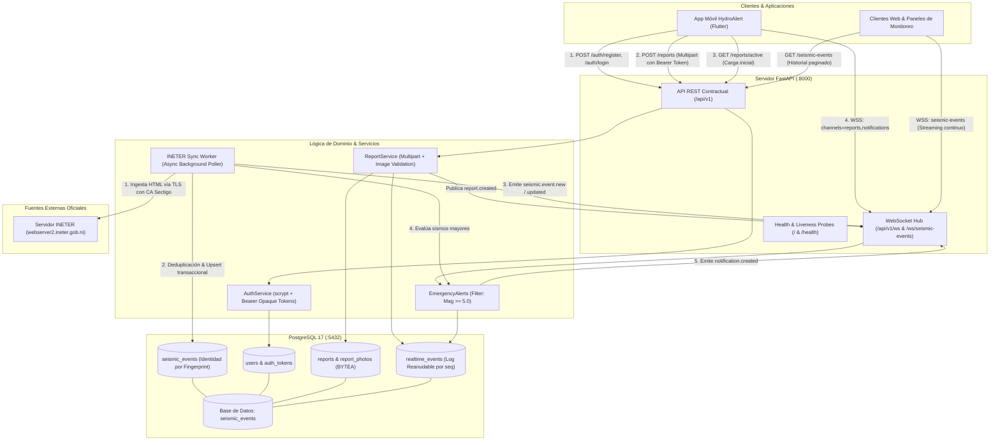

# HydroAlert Backend

Plataforma de alta disponibilidad desarrollada en **FastAPI**, **PostgreSQL 17** y **WebSockets** para la monitorización sísmica en tiempo real del Instituto Nicaragüense de Estudios Territoriales (**INETER**), gestión comunitaria de reportes ciudadanos con soporte fotográfico, y emisión inmediata de alertas tempranas de emergencia.

---

## 1. Diagrama de Arquitectura y Comunicación

El sistema opera desacoplando la ingesta de datos externos, el procesamiento transaccional, el almacenamiento persistente y la distribución reactiva a múltiples clientes:



---

## 2. Stack Tecnológico

- **Lenguaje y Core:** Python 3.13, FastAPI y Uvicorn ASGI.
- **Persistencia y ORM:** PostgreSQL 17, SQLAlchemy 2 (async) y driver `asyncpg`.
- **Migraciones de Esquema:** Alembic con ejecución asíncrona.
- **Cliente HTTP y Scraping:** `httpx` (con timeouts y retries con backoff) y `BeautifulSoup4`.
- **Seguridad y Criptografía:** `hashlib.scrypt` para hashes de contraseñas, SHA-256 para tokens opacos `hl_...` y normalización estricta de cédula nicaragüense.
- **Almacenamiento de Fotos:** `python-multipart` con detección por *magic bytes* y guardado directo en base de datos (`BYTEA`) para portabilidad total en contenedores.
- **Testing:** `pytest`, `pytest-asyncio`, `pytest-env` y verificación contra base de datos PostgreSQL real.
- **Contenedores:** Docker y Docker Compose v2 multi-stage build.

---

## 3. Plan de Ejecución de la API (Paso a Paso)

Sigue estos pasos ordenados para poner en marcha el backend de manera limpia y sin errores.

### Prerrequisitos

- **Docker Desktop** con Docker Compose v2 instalado y activo.
- Si ejecutas en local sin Docker: **Python 3.13** y **PostgreSQL 17** instalado.

---

### Paso 1: Configurar las variables de entorno

Crea tu archivo `.env` a partir de la plantilla:

```powershell
# En Windows (PowerShell)
Copy-Item .env.example .env

# En Linux / macOS
cp .env.example .env
```

> [!IMPORTANT]
> Abre el archivo `.env` recién creado y actualiza `POSTGRES_PASSWORD` y `PGADMIN_DEFAULT_PASSWORD` por contraseñas seguras para tu entorno.

---

### Paso 2: Iniciar los contenedores con Docker Compose

Construye las imágenes e inicia la base de datos, pgAdmin y la API:

```powershell
docker compose up -d --build
```

Verifica el estado de los servicios:

```powershell
docker compose ps
```

Los servicios `backend-db-1` y `backend-api-1` deben figurar en estado `Up (healthy)`.

---

### Paso 3: Generar y Aplicar las Migraciones de Base de Datos

Al tratarse de un repositorio público limpio, los archivos de versión de migraciones locales no se versionan en Git. Debes generar tu migración inicial en el contenedor:

```powershell
# 1. Generar la revisión inicial a partir de los modelos de dominio
docker compose exec api alembic revision --autogenerate -m "initial_schema"

# 2. Aplicar la migración a la base de datos PostgreSQL
docker compose exec api alembic upgrade head

# 3. Confirmar que la base de datos está al día
docker compose exec api alembic current
```

---

### Paso 4: Comprobación Operativa y Acceso

Una vez aplicadas las migraciones, la API está completamente operativa:

| Servicio | URL | Descripción |
| --- | --- | --- |
| **API Health** | `http://localhost:8000/api/v1/health` | Estado del worker, base de datos y clientes |
| **Swagger UI** | `http://localhost:8000/docs` | Documentación interactiva OpenAPI |
| **ReDoc** | `http://localhost:8000/redoc` | Especificación REST |
| **pgAdmin** | `http://localhost:5050` | Administrador visual de PostgreSQL |

---

### Paso 5: Ejecución de la Suite de Pruebas

Para validar que todo el código cumple con los contratos:

```powershell
# Dentro del contenedor api:
docker compose exec api pytest -q

# O localmente si tienes un entorno virtual activo:
cd api
pytest -q
```

Resultado esperado: **110 passed** (unitarias, validaciones y contratos HTTP/WebSocket).

---

## 4. Guía de Migraciones (Alembic)

### Comandos frecuentes de migraciones

- **Crear una nueva migración (tras modificar un modelo ORM):**

  ```powershell
  docker compose exec api alembic revision --autogenerate -m "nombre_del_cambio"
  ```

- **Aplicar todas las migraciones pendientes:**

  ```powershell
  docker compose exec api alembic upgrade head
  ```

- **Ver la versión actual aplicada:**

  ```powershell
  docker compose exec api alembic current
  ```

- **Ver el historial de migraciones:**

  ```powershell
  docker compose exec api alembic history --verbose
  ```

- **Revertir la última migración aplicada:**

  ```powershell
  docker compose exec api alembic downgrade -1
  ```

---

## 5. Referencia de la API

Todos los endpoints están disponibles bajo el prefijo contractual `/api/v1` y, para máxima compatibilidad con clientes cuya `API_BASE_URL` apunta a la raíz, los endpoints de autenticación y reportes también responden directamente sin prefijo.

### Endpoints REST

| Método | Endpoint | Autenticación | Descripción |
| --- | --- | --- | --- |
| `GET` | `/` | Pública | Liveness probe para orquestadores y Docker |
| `GET` | `/api/v1/health` | Pública | Readiness probe: verifica PostgreSQL, worker y sockets |
| `POST` | `/api/v1/auth/register` | Pública | Registra un usuario reportante (acepta cédula nica) |
| `POST` | `/api/v1/auth/login` | Pública | Inicia sesión y emite token Bearer opaco (`hl_...`) |
| `GET` | `/api/v1/reports/active` | Pública | Lista los 100 reportes ciudadanos más recientes |
| `POST` | `/api/v1/reports` | `Bearer <token>` | Crea un reporte ciudadano con foto multipart |
| `GET` | `/api/v1/reports/photos/{id}` | Pública | Sirve la imagen binaria con caché inmutable |
| `DELETE` | `/api/v1/reports/{id}` | `Bearer <token>` | Desactiva un reporte (exclusivo para su autor) |
| `GET` | `/api/v1/seismic-events` | Pública | Consulta histórica paginada con filtros de magnitud y fecha |
| `GET` | `/api/v1/seismic-events/{id}` | Pública | Detalle de un sismo específico por UUID |

### Canales WebSocket

#### 1. Canal contractual HydroAlert (`/api/v1/ws` y `/ws`)

Diseñado para la app móvil HydroAlert. Soporta selección de canales, latidos (*heartbeat*) y reanudación por `lastEventId`:

- **Conexión:** `ws://localhost:8000/api/v1/ws?channels=reports,notifications&lastEventId=evt_...`
- **Handshake:** Emite `connection.ready` confirmando canales y el flag `resumed`.
- **Latido:** Cliente envía `{"action": "ping"}`; el servidor responde con `pong` y hora UTC.
- **Eventos emitidos:**
  - `report.created`: Nuevo reporte ciudadano creado.
  - `report.deleted`: Desactivación de reporte `{ "id": "rep_..." }`.
  - `notification.created`: Alertas críticas de emergencia (`type: "emergency"`).

#### 2. Canal sísmico INETER (`/ws/seismic-events`)

Canal dedicado al streaming en vivo de eventos sísmicos capturados por el worker:

- **Conexión:** `ws://localhost:8000/ws/seismic-events`
- **Eventos:** Entrega snapshot inicial (`seismic.events.initial`) y transmisiones en vivo (`seismic.event.new`, `seismic.event.updated`).

### Formato de Errores Estandarizado (Inglés)

Las respuestas de error siguen el estándar internacional en inglés:

```json
{
  "error": {
    "code": "email_already_registered",
    "message": "Email is already registered."
  },
  "message": "Email is already registered."
}
```

Códigos de respuesta:

- `400 Bad Request`: Formato de solicitud inválido o datos malformados.
- `401 Unauthorized`: Token ausente, inválido o credenciales erróneas.
- `403 Forbidden`: Acción no autorizada (por ejemplo, borrar un reporte ajeno).
- `404 Not Found`: Recurso no encontrado.
- `409 Conflict`: Correo o cédula ya registrados previamente.
- `413 Payload Too Large`: Fotografía superior al límite de 5 MB.
- `422 Unprocessable Entity`: Error de validación semántica o formato de foto no soportado.
- `429 Too Many Requests`: Tasa de peticiones excedida (incluye cabecera `Retry-After`).
- `500 Internal Server Error`: Excepción no controlada en el servidor.

---

## 6. Variables de Entorno

| Variable | Valor por defecto | Descripción |
| --- | --- | --- |
| `POSTGRES_USER` | `admin` | Usuario de PostgreSQL |
| `POSTGRES_PASSWORD` | `change-me` | Contraseña de PostgreSQL (definir en `.env`) |
| `POSTGRES_DB` | `seismic_events` | Nombre de la base de datos |
| `POSTGRES_HOST` | `db` | Host del servidor PostgreSQL |
| `POSTGRES_PORT` | `5432` | Puerto de conexión a PostgreSQL |
| `APP_ENV` | `production` | Entorno: `development`, `production` o `test` |
| `LOG_LEVEL` | `INFO` | Nivel de registros estructurados en JSON |
| `CORS_ALLOW_ORIGINS` | `*` | Orígenes CORS permitidos |
| `INETER_URL` | URL Oficial | Página de sismos de INETER |
| `INETER_POLL_INTERVAL_SECONDS` | `120` | Intervalo de scraping de sismos (segundos) |
| `INETER_CA_BUNDLE` | `certs/sectigo-...pem` | Certificado intermedio Sectigo para TLS |
| `EMERGENCY_MIN_MAGNITUDE` | `5.0` | Umbral para emitir notificaciones críticas de sismo |
| `REPORT_PHOTO_MAX_BYTES` | `5242880` | Tamaño máximo de fotografías (5 MB) |
